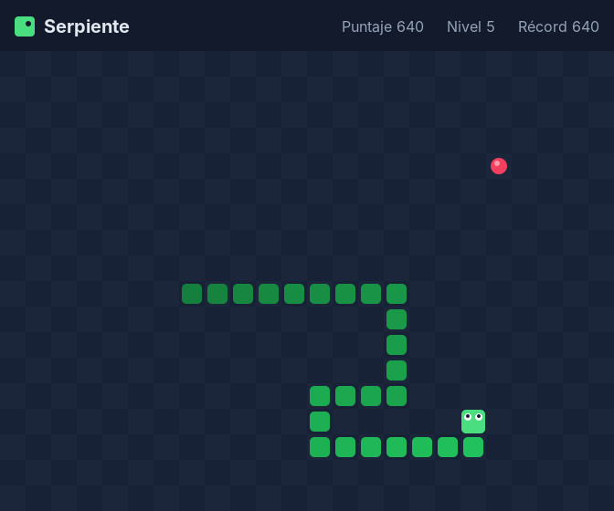

# 🐍 Día 04 · Juego de la serpiente en Java

El clásico juego de la serpiente (el de los celulares Nokia), hecho en Java con Swing: come, crece, sube de nivel y no te choques.

**Frente:** Videojuegos / aplicaciones de escritorio · **Lenguaje:** Java 21 · **Librerías:** solo las de Java (Swing)



## Funcionalidades

- Controles con **flechas o WASD**.
- **Niveles:** cada 5 comidas sube el nivel, la serpiente va más rápido y cada comida vale más puntos.
- **Récord guardado:** el mejor puntaje se guarda en un archivo y no se pierde al cerrar el juego.
- **Pausa** con Espacio o P, **reinicio** con Enter y salida con Esc.
- **Giros rápidos sin errores:** si presionas dos teclas muy seguido, ambas se aplican en orden.
- No permite devolverse sobre sí misma, y sí puede perseguir su propia cola.
- 12 pruebas automáticas de las reglas del juego.

## 1. Instalar Java (solo una vez)

1. Entra a **https://adoptium.net** y descarga **Temurin 21 (LTS)** para Windows (archivo `.msi`).
2. En el instalador, en la pantalla de opciones, activa **"Set JAVA_HOME variable"** (y deja activado "Add to PATH").
3. **Cierra y vuelve a abrir PowerShell** y verifica:
   ```powershell
   java -version
   javac -version
   ```

## 2. Jugar

Dentro de la carpeta del proyecto:

```powershell
.\ejecutar.ps1
```

O sin el script:

```powershell
javac -encoding UTF-8 -d out (Get-ChildItem -Recurse -Filter *.java src).FullName
java -cp out serpiente.Main
```

## 3. Pruebas

```powershell
.\pruebas.ps1
```

Debe terminar en `12 pruebas pasaron, 0 fallaron`.

## 4. Crear un ejecutable `.jar`

```powershell
.\crear-jar.ps1
java -jar serpiente.jar
```

Con Java instalado, `serpiente.jar` también se puede abrir con doble clic.

## Controles

| Tecla | Acción |
|---|---|
| ↑ ↓ ← → o W A S D | Mover |
| Enter | Empezar / jugar otra vez |
| Espacio o P | Pausar |
| Esc | Salir |

## Estructura

```
dia-04-serpiente/
├── src/serpiente/
│   ├── Main.java                 # Crea la ventana y arranca el juego
│   ├── modelo/                   # LAS REGLAS (no sabe nada de ventanas)
│   │   ├── Juego.java            #   Movimiento, choques, puntaje, niveles
│   │   ├── Serpiente.java        #   El cuerpo (una cola de doble extremo)
│   │   ├── Posicion.java         #   Una celda (record)
│   │   ├── Direccion.java        #   Arriba, abajo, izquierda, derecha (enum)
│   │   └── EstadoJuego.java      #   Listo, jugando, pausado, perdido, ganado
│   ├── vista/
│   │   └── PanelJuego.java       # EL DIBUJO y el teclado (Swing)
│   └── datos/
│       └── MejorPuntaje.java     # Guarda el récord en un archivo
├── test/serpiente/modelo/
│   └── PruebasJuego.java         # 12 pruebas de las reglas
├── ejecutar.ps1 · pruebas.ps1 · crear-jar.ps1
└── capturas/
```

## Qué se practica en Java

| Concepto | Dónde está |
|---|---|
| Clases, objetos y encapsulamiento (`private` + métodos públicos) | `Juego`, `Serpiente` |
| Separar modelo y vista (las reglas no dependen de la ventana) | `modelo/` vs `vista/` |
| `enum` con atributos y métodos | `Direccion` (`esOpuestaA`) |
| `record` (clases de datos inmutables) | `Posicion` |
| Colecciones: `Deque`, `ArrayDeque`, `List` | `Serpiente`, `Juego` |
| `switch` moderno con `->` | `PanelJuego` (teclado y mensajes) |
| Herencia y clases internas | `PanelJuego extends JPanel`, `Teclado extends KeyAdapter` |
| Bucle de juego con `javax.swing.Timer` | `PanelJuego` |
| Dibujo 2D con `Graphics2D` | `paintComponent()` |
| Lectura y escritura de archivos (`java.nio.file`) | `MejorPuntaje` |
| Manejo de excepciones (`try/catch`) | `MejorPuntaje` |
| Pruebas sin librerías externas | `PruebasJuego` |

## Retos extra

1. **Fácil:** cambiar los colores o el tamaño del tablero (constantes en `PanelJuego` y `Main`).
2. **Fácil:** que los bordes no maten y la serpiente aparezca por el otro lado.
3. **Medio:** una comida dorada que aparece de vez en cuando, vale 50 puntos y desaparece a los 5 segundos.
4. **Medio:** obstáculos (muros) que aparecen al subir de nivel.
5. **Avanzado:** modo de dos jugadores en el mismo teclado (flechas vs WASD).
